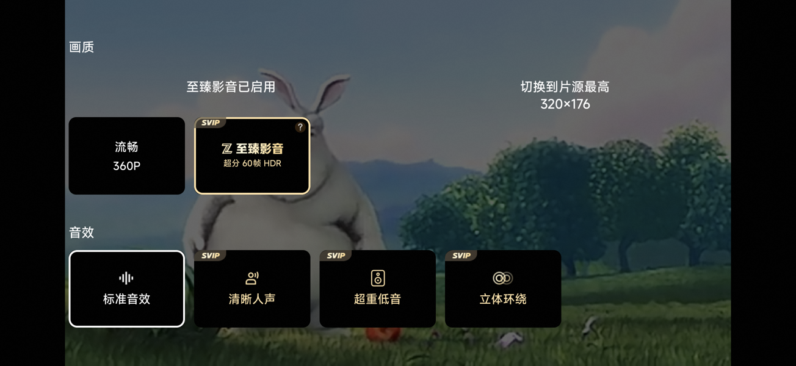

# 1.4 网页至臻影音定点验证

验证日期：2026-11-22。环境：Android 17、LSPosed 2.2.1、夸克 `com.quark.browser` 版本 `10.21.6.1191`（1191）。模块启用 `webvideo` 和诊断日志，仅作用于夸克。

本次修复替换了 1.3 版只调用原生会员选择动作的实现。画质面板观察者实际是 `Manipulator`，模块从它的状态提供者获取当前 `MediaPlayer`，并核对面板与播放器对应相同状态对象，然后调用 Apollo 本地增强流程。

测试片源：[W3Schools 的 Big Buck Bunny MP4](https://www.w3schools.com/html/mov_bbb.mp4)，实际尺寸 `320×176`，时长约 10 秒。

## 已观察结果

- 全屏画质／音效面板上方点击新增「至臻影音」入口，未出现开通／支付窗口。
- 最终 1.4 构建的内核诊断结果如下，13 次滤镜参数更新全部返回接受：

```text
intelligent cinema rw.instance.add_filter accepted=true
intelligent cinema rw.instance.enable_filter accepted=true
intelligent cinema active: added=1 enabled=1 updated=13
```

- 滤镜启用后视频继续播放。重新打开原生面板，AI 档位高亮，上方按钮显示「至臻影音已启用」。
- 点击「切换到片源最高 320×176」后，夸克显示「已切换至 流畅 画质」，视频继续播放。该样片只有一个普通片源档位。
- Java 编译、Android Lint、Debug APK 组装及 APK 签名校验通过。最终构建已安装到连接设备。



## 尚未验证的范围

- 未测量实际输出帧率和 HDR 输出。代码调用原生高帧率流程，但该设备本次未发出 `rw.instance.set_target_fps` 命令，不能声称已经输出 60 帧。
- 未进行逐帧图像质量测量；原生滤镜命令成功与播放状态是本次运行证据。
- 未验证多档 4K、网盘原画或其他机型。片源最高功能只在夸克已返回、可访问且有实际媒体地址的普通网页档位中按宽高选择，不设置分辨率上限；不会生成站点未返回的原画链接。
- 会员音效、账号会员状态及云端服务没有在此修改中实现。
